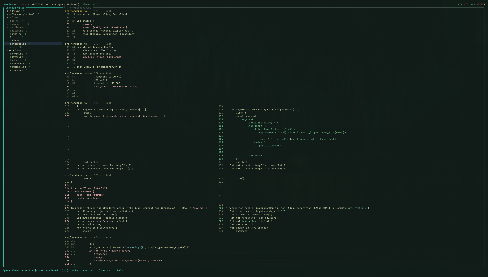

# Review

A keyboard-driven branch review TUI built with Rust and Ratatui. Browse a file
tree, read syntax-aware diffs from [Difftastic](https://difftastic.wilfred.me.uk/),
mark files viewed, and pick up where you left off.



## Install

Requires Rust 1.88+, Git, and `difft` on `PATH`. Jujutsu reviews use `jj` 0.46+
(the structured diff template interface).

```sh
cargo install --path .
```

## Start a review

```sh
# Review the current directory's repository against master
review

# Compare two change/commit IDs, branches, or bookmarks directly
review ukr..vqm
review master..feature/my-change

# Compare a revision or branch against the current revision (@)
review ukr..
review ukr..@
review master

# Review the changes introduced by one revision
review ukr
review --backend git HEAD~3

# Native revision expressions
review 'trunk()..@'
review --backend git 'HEAD~3..@'

# Git: review the current branch against its merge base with master
review --base master

# Git merge-base shorthand
review --backend git master...feature/my-change

# Explicit merge-base branch comparison
review --base origin/master --head feature/my-change

# Jujutsu: review the working-copy revision against trunk
review --base 'trunk()' --head @

# Select a repository and backend explicitly
review -C ../project --backend git --base master
```

A saved review ID or unique prefix, such as `review r3`, resumes that session for
the current repository/backend. Saved-session matches take precedence over revision
names; use `review r3..@` to compare a revision with the same name. Ambiguous session
prefixes list the matching IDs.

Otherwise, positional `BASE..HEAD` compares the two snapshots directly. Either
omitted endpoint defaults to `@`, which selects Git's current `HEAD` or Jujutsu's
working-copy revision. A lone Git branch or Jujutsu bookmark name means `BRANCH..@`.
A lone revision ID or expression compares that revision to its first parent, or
to the empty tree for an initial commit. Each endpoint accepts the selected
backend's revision syntax and resolves to one revision. Quote expressions
containing shell metacharacters.

Bare `review` defaults to `--base master`. Use `--base` with an optional `--head`
to compare from their unique merge base; Git's positional `BASE...HEAD` uses the
same merge-base behavior. This focuses the review on changes made on the head
branch since the histories diverged.

The nearest repository is detected automatically from the current directory,
with Jujutsu preferred in a colocated workspace. The header displays the resolved
snapshot IDs and commit titles. Jujutsu reviews show each endpoint's change ID and
Git commit hash, such as `master (ukrwmnxy abcdef12) Initial import`. Titles use the
first line of each pinned commit's message, up to 50 characters, and shorten to fit
the available header space while preserving the revision labels and line counts.
Added and removed line counts appear at the right edge of the header in green
and red: `+12 -3 · +120 -45 total · +30 -8 tests`. The first pair covers the
highlighted file or folder; folder counts include all changed descendants,
including viewed files and files hidden by filters or collapsed folders. The
`total` pair covers the full comparison. The `tests` pair totals changed files in
directories named `test`, `tests`, `spec`, or `specs`, or with `.test.` or `.spec.`
in the filename. All counts follow the pinned snapshots when resuming or refreshing.

File titles in the diff pane list the commits that changed the file within the
comparison, oldest first: `M packages/api/README.md [xnp, qrl]`. IDs use shortest
unique jj change prefixes (at least three characters) when jj can read the
repository, and short Git hashes otherwise. File history follows the pinned
comparison when resuming or refreshing.

With a file selected, press `,` / `.` to select its previous/next revision. The
first `.` selects the oldest revision, and the first `,` selects the newest.
Navigation wraps at either end. The active revision is highlighted in the diff
pane's title, and the diff shows that revision's changes to the file.

Press `Shift-,` / `Shift-.` (`<` / `>`) to extend the selection from its anchor.
Reversing direction shrinks the range, and extension stops at either end of the
file's revision list. Ranges include both endpoints and show the combined diff
from the oldest selected revision's parent to the newest selected revision.
The line `Only showing changes from <revision-range>` stays above the diff while
scrolling. Each revision includes the first line of its commit message, such as
`Only showing changes from oly (Frobnicated the foobazinator)`. Ranges show the
message for each endpoint. Press `Esc` or select another file to restore the full
comparison.

Reviews check the selected revisions in the background about once per second.
Jujutsu `@` follows saved working-copy edits; Git comparisons follow commits as
`HEAD` or branches advance. File trees, file and directory previews, header IDs and
titles, and line totals reload together. Updates save automatically, preserving
selection, pane focus, and scroll positions for unchanged diffs.

Jujutsu checks snapshot the working copy through `jj`, then read file contents at
fixed revisions.

## Review a GitLab merge request

Install the [GitLab CLI (`glab`)](https://docs.gitlab.com/cli/) and authenticate:

```sh
review gitlab login
review gitlab login --hostname gitlab.example.com
review gitlab login --web       # Browser OAuth
review gitlab login --device    # Device OAuth for headless environments
```

Login shares `glab`'s credentials and works outside a repository. Repository
fetches use your SSH keys or HTTPS credential helper. For HTTPS token access,
`glab auth login --setup-git-credential-helper` configures the helper.

```sh
review gitlab                   # Pick an open MR in this repository
review gitlab 123               # Review a particular MR
review gitlab https://gitlab.example.com/group/project/-/merge_requests/123
review -C ../project gitlab --remote upstream
review gitlab --hostname gitlab.example.com # Override an SSH hostname alias
```

The picker groups open MRs into **Unreviewed**, **Approved**, and **Changes requested**.
Only approvals and change requests count as review decisions, so comment-only
reviews appear under **Unreviewed**. An active change request takes precedence over
an approval.
Each section shows the most recently updated MRs first, with titles, authors,
draft status, and source/target branches. MRs you've approved are dimmed.
Use `j` / `k` or arrows to move, `Enter` to select, `/` to search, `r` to reload,
and `Esc` to cancel. All result pages are included. Multiple repository remotes
offer a selector; `--remote` chooses one directly. MR URLs select a matching
target-project remote, including projects in nested namespaces.

Selecting an MR fetches its source and target branches and prepares the current
working copy. Git creates or fast-forwards the source branch. Jujutsu fetches the
source bookmark and creates a clean working-copy change on its head, keeping the
reviewed commit intact. Fork MRs reuse a matching source remote or add one named
`review-gitlab-<project-id>`.

**Local edits and divergent Git branches require attention before switching.**
Review stops with instructions rather than discarding work or resetting history.

If `conductor` is available on `PATH`, Review asks whether to check out and
run the MR in Conductor. Choose `y` to let Conductor switch the source branch
and start the workspace, or press `Enter` for Review's regular checkout. Run
Review in a registered, initialized, stopped Treefort workspace to use Conductor.
**Only run branches you trust:** Conductor fetches the current head of the branch
and runs its code with access to the workspace's development environment.

The comparison uses GitLab's recorded merge-base and source-head snapshots. MR
identity and complete diff references are saved with the session, so resume and
local comments retain their reviewed version. The header shows the MR's title and
target/source branch labels with pinned snapshot IDs. Press `r` to fetch and
prepare the latest MR version, preserving matching viewed markers and comment
anchors. For Conductor-managed reviews, `r` updates the review snapshots and
leaves the workspace on its current checkout. GitLab requests and fetches have
a 90-second command timeout, and refresh runs in the background.

### Read existing GitLab comments

Opening an MR also loads its existing discussions. Press `C` for an overview of
line comments, review summaries, and conversation threads alongside local comments.
Use `j` / `k` to select an entry and `Enter` to open it in the comments pane and
jump to its source range. Each GitLab thread shows its author, replies, creation
times, resolved status, and conversation link. Older-version discussions remain
available with an outdated label. File-tree counts and diff-line markers include
existing discussions.

Highlight a commented line and press `o` to reveal the comments pane and read its
conversation. `]c` / `[c` open the next/previous thread in the current file or
directory preview. General and historical conversations also open in this pane.

Within the comments pane, `j` / `k` or `n` / `N` select threads, while `PageUp` /
`PageDown` or `Ctrl-u` / `Ctrl-d` scroll the expanded conversation. `Enter`, `o`,
or `Esc` collapses it back to the source-aligned view. `Ctrl-h/j/k/l` and
`Tab` / `BackTab` move between panes.

Comment readers render Markdown, including emphasis, lists, quotes, links,
fenced code, and tables. While composing a comment or reply, `Ctrl-p` toggles
between editing Markdown and its rendered preview.

Discussions are saved with the session and reloaded when resuming an MR review.
Press `r` inside the comments browser to reload conversations while keeping the
reviewed snapshots and working copy. The normal `r` refresh updates both the MR
snapshots and discussions. Local feedback and publication receipts are preserved
through reloads, and cached conversations stay available if GitLab is unreachable.

### Reply to a thread

Press `R` in a GitLab thread or on its entry in `C` to open the reply editor in
the comments pane. Write the reply, then `Ctrl-s` saves it locally beneath the
conversation and returns to the thread. `R` reopens a pending reply
for editing; `d`, then `y`, discards the pending reply. `Ctrl-q` discards unsaved
composer edits. Replies to general, resolved, and historical conversations retain
the original GitLab discussion identity.

Press `P` to preview and publish pending replies together with line comments and
the review summary. Replies use native GitLab draft notes and the same saved
write intents, receipts, and uncertain-response recovery as line comments.
Staged replies remain attached to their submission receipts.

### Submit a GitLab review

Compose comments with `c` and save each locally with `Ctrl-s`. Press `P` to
prepare a GitLab review in the comments pane. Use `Tab` to switch between the
Markdown summary and pending comments/replies. Use `j` / `k` to select feedback
and `PageUp` / `PageDown` to scroll its source and text.

Press `Ctrl-o` to cycle through **Comment**, **Approve**, and **Reject**.
The summary border shows your choice next to a yellow chat bubble, green
checkmark, or red X, respectively.
Choose **Approve** and leave the summary blank to send just an approval when
there are no comments, replies, or pending GitLab drafts. When publishing a
review with feedback or requesting changes, an empty summary uses the default
text “Review completed.”

Press `Ctrl-s` to check the current MR version, source anchors, authenticated
account, and pending GitLab drafts. Then press `y` to confirm, or `n` / `Esc` to
return to editing. Token authentication requires the `api` scope for submission.
Review publishes any feedback as native GitLab draft notes before approving the
reviewed head commit. Request changes uses GitLab's native review state and
requires server and project support; Review reports whether GitLab recorded it.

**Publishing includes all of your pending GitLab drafts on this MR.** The
confirmation shows the count of drafts from outside the session, including
browser-created drafts. Changes to those drafts during submission require a fresh
preview and confirmation.

Comments on added, removed, unchanged context, and renamed-file lines use GitLab's
recorded diff positions. Inclusive ranges become multiline GitLab comments.
Outdated anchors and lines outside GitLab's available diff are flagged for
correction before staging. MR updates and retargeting require another refresh and
review.

Submission intents, draft IDs, and published-note receipts are saved after each
step. Hidden identity markers associate remote notes with local comments, allowing
an interrupted request to be reconciled on the next preview. `C` shows draft,
published, and uncertain statuses. Submitted comments retain their original text
and receipts; add a new comment for further feedback.

If a response is lost, press `Ctrl-s` in the submission dialog to recheck GitLab.
If the feedback was published but the approval is still pending, `Ctrl-s` lets
you confirm just the approval. Use `X`, then `y`, to clear a pending decision
from the session after checking GitLab; published feedback stays on the MR.
**Check the MR in GitLab before acknowledging an uncertain retry:** a previous
write may already be visible. `X`, then `y`, acknowledges that risk and allows a
fresh preview. While GitLab owns the session writer, the app finishes the
operation before quitting so submission checkpoints stay consistent.

## Stop and resume

```sh
review last                  # Open the most recently opened review
review --resume              # Resume the most recently saved session
review --list                # List saved sessions for this repository/backend
review r3                    # Resume a particular saved review.
review --resume r3           # Resume a particular session
review --rename r3 "API review" # Give a saved session a display name
review --base master         # Start a fresh review
```

`-r` is a shortcut for `--resume`: use `review -r` for the latest session or
`review -r r3` for a particular session.

`review last` opens the most recently opened review for the current repository,
including reviews saved with either Git or Jujutsu. Outside a repository, it opens
the most recently opened review across all repositories and uses that review's
saved repository and backend. `-C <directory>` selects the starting directory;
`--backend git` or `--backend jj` narrows the history to that backend. Selection
uses the last-opened timestamp, with the last saved time for older sessions.
Resuming restores the existing session and updates its last-opened time.

New sessions use short IDs: `r1`, `r2`, `r3`, and so on, starting at
`r1` for each repository/backend. IDs stay with their sessions as progress is saved,
and deleted sessions' numbers become reusable after seven days. New reviews reuse
the lowest eligible number before allocating a fresh one. After reuse, the ID
identifies the new review. The `r` prefix keeps these IDs distinct from older hash
IDs. Existing saved IDs and unique prefixes remain valid.
On a terminal, `review --list` highlights each session's shortest unique prefix in
bold magenta. Ambiguous prefixes report the matching IDs so you can choose a longer
prefix. Piped listings use plain IDs; `NO_COLOR=1` also selects plain terminal output.

Each `review --list` entry includes its last-opened datetime in UTC, for example
`Opened 2026-10-28T08:30:00Z`. Creating or resuming a review records this time.
Older sessions use their last saved time until their next resume.

Session names appear beside their stable IDs in `--list`, the TUI header, and the
session dialog. `review --rename <ID> <NAME>` accepts a full ID or unique prefix
and renames a closed session. Use `review --rename r3 ""` to clear its name.
Renaming preserves the session's review data, last-opened time, and listing order.
IDs and unique prefixes continue to select named sessions for resume and management.

Press `q` to save and quit from any screen outside a focused input. `Ctrl-c`
also quits while an input is focused. Viewed changes save immediately;
navigation state autosaves within 250 ms. Line comments save immediately when
submitted. Resume restores comments, the comparison,
viewed files, selection, pane focus, directory expansion, filters, layout,
tree width, and per-file and per-directory scroll positions.

Sessions belong to the canonical workspace path and selected backend. Use the
same backend when resuming a session created with `--backend git` in a colocated
workspace.

**Resume restores the original snapshots.** Subsequent changes while the review is
open trigger an automatic refresh. Press `r` to resolve the original branch/revision
expressions immediately using the same comparison mode. A viewed marker survives
when both sides of the file change—including paths, types, and executable bits—are
identical. Changes to either side reset its marker; equivalent history rewrites
preserve it. Changed files reappear in the unviewed-only filter.
Keep reviewed commits reachable while a session is active: file rendering reads
their stored objects.

State lives in `$XDG_STATE_HOME/review/` (normally `~/.local/state/review/`). Use
`--state-dir <directory>` for a different location. Saves are atomic, and each
open session holds an exclusive lock.

### Manage saved sessions

```sh
review --forget r3             # Forget one session by ID or unique prefix
review --forget r3 r7          # Forget several sessions
review --forget-all            # Forget every closed session in this repository/backend
review --forget-all --yes      # Confirm immediately, suitable for scripts
review --cleanup              # Forget closed reviews last opened over a week ago
review --cleanup --yes        # Confirm stale-review cleanup immediately
```

The CLI asks for confirmation; `-y` / `--yes` confirms explicitly for automation.
All requested IDs and session locks are checked before deletion. Open sessions
are protected, and `--forget-all` selects closed sessions.

`--prune` is an alias for `--cleanup`.

`--cleanup` selects this repository/backend's closed sessions whose last-opened
time is strictly more than seven days ago. Older sessions use their last saved
time. Cleanup asks for confirmation and rechecks the selected sessions' age and
locks before deletion. Use `--cleanup --yes` for automation. Deleted numbers follow
the same seven-day reuse cooldown as manually forgotten sessions.

Press `S` from either pane to open the session dialog. It shows session IDs, names,
comparisons, viewed progress, and current/open indicators. Use `j` / `k` or arrows
to move, `Space` to toggle selections, and `a` to select all closed sessions or
clear the selection, including sessions outside the viewport. `gg` / `G` and the
page-scrolling keys also work. Press `d`, `Delete`, or `Enter` to review the
confirmation, then `y` to delete or `n` / `Esc` to cancel. `r` reloads the list;
`Esc` closes the dialog and returns to the review.

Press `R` to rename the highlighted session, including the current review. Edit or
paste its name, then press `Enter` to save or `Esc` to cancel. Arrow keys, `Home`,
`End`, `Backspace`, and `Delete` edit the text; `Ctrl-u` clears it. Saving an empty
name clears the label. Sessions open in another review remain protected by their
locks, which are rechecked when saving the name.

Forgetting permanently removes the session's saved comments, progress, and navigation state.
Repository content and persistent editor snapshots are preserved.

## Keyboard controls

| Keys | Action |
|---|---|
| `j` / `k`, arrows | Move in the tree, scroll the diff, move a highlighted line, or select a comment thread. |
| `Ctrl-n` / `Ctrl-p` | Next/previous visible tree row, keeping pane focus and layout |
| `h` / `l` | Collapse/expand directories, scroll horizontally, or choose old/new side |
| `Enter` | Toggle a directory, focus a file's diff, highlight a source line, or read a comment thread. |
| `Tab` / `BackTab` | Cycle forward/backward through visible panes. |
| `Ctrl-h` / `Ctrl-k`, `Ctrl-l` / `Ctrl-j` | Focus the previous or next pane. |
| `Ctrl-Left` / `Ctrl-Up`, `Ctrl-Right` / `Ctrl-Down` | Shrink or grow the active split by two columns. |
| `gg` / `G`, `Home` / `End` | First/last row or page |
| `Ctrl-d/u` | Scroll the diff by half a page from either pane, keeping pane focus. |
| `Ctrl-f/b`, `PageDown/Up` | Scroll the focused pane by a full page. |
| `Space` | Toggle viewed status for a file or folder; advance when marking a file. |
| `,` / `.` | Select the previous/next revision that changed the file. |
| `Shift-,` / `Shift-.` (`<` / `>`) | Extend the selected revision range. |
| `]f` / `[f` | Next/previous file, expanding its parents |
| `]u` / `[u` | Next/previous unviewed file |
| `]h` / `[h` | Select and highlight the next/previous diff hunk |
| `]Nh` / `[Nh` | Select hunk number `N` (1-based) |
| `e` | Open the selected file or hunk in the editor, or edit a local comment in the comments pane. |
| `Y` | Copy the selected file or directory's absolute path to the clipboard |
| `D` | Restore the selected file or highlighted lines from the review base. |
| `c` | Compose a comment on the selected diff lines in the comments pane. |
| `o` | Read or collapse a thread in the comments pane. |
| `]c` / `[c` | Open the next/previous thread in the current preview |
| `v` | Start a range at the highlighted line; `j` / `k` extend, `v` returns to one line |
| `C` | Open the thread overview; `Enter` reads the selected thread in the comments pane. |
| `R` | Reply to the selected GitLab thread in the comments pane. |
| `t` | Show or hide the source-aligned comments pane. |
| `P` | Preview and submit comments as a GitLab review |
| `/` | Filter filenames in the tree; search text in the diff |
| `s` | Flash jump to a visible tree entry from either pane |
| `S` | Manage, rename, and forget saved sessions with multiselect |
| `n` / `N` | Next/previous matching file or diff search result |
| `u` | Toggle the unviewed-only filter |
| `i` | Toggle inline and side-by-side rendering |
| `+` / `-` | Increase or decrease diff context by one line. |
| `z` | Toggle a full-width diff |
| `Esc` | Clear file and revision filters, or cancel a search or Flash prompt. |
| `r` | Refresh the comparison |
| `?` | Show help and custom key aliases |
| `q`, `Ctrl-c` | Save and quit. A focused input keeps `q` for editing. |

Marking a file viewed advances to the next unviewed file matching the current
filter, expanding its parent folders and wrapping at the end. Pane focus and
layout are retained. Unmarking keeps the current file selected.

Press `Y` (`Shift-y`) from either pane to copy the highlighted file or folder's
absolute path using the terminal's OSC 52 clipboard support.

Search and filtering are case-insensitive. Directory counts show progress across
their changed files. Pressing `Space` on a folder marks all its changed files
viewed, including nested files and files hidden by filters or collapsed folders.
Pressing it on a fully viewed folder unmarks all its changed files.
Highlighting a folder shows a combined diff of all its changed descendants,
including collapsed and filtered-out files, with a heading for each file.
Focus the right pane with `Ctrl-l` or `Tab` to scroll or search the combined diff.
`Space` in a directory preview toggles viewed status in the same way.
Viewed files and fully viewed folders appear slightly dimmed in the tree.
Narrow terminals display the focused pane at full width.
When the rendered diff is taller than its pane, a right-edge scrollbar shows your
position and how much of the diff is visible.

The comments pane starts hidden. Press `t` to show it to the right of the diff.
Reading a thread, composing or editing a comment, replying, or preparing a GitLab
review automatically reveals this pane.
Threads align with their source lines and follow diff scrolling and re-rendering.
Threads that would overlap collapse into one-line summaries showing the commenter,
timestamp, reply count, and opening words as space allows. Threads on the same
line share a summary that shows the thread count and the selected thread's details.
Resolved threads have a checkmark and start collapsed.

Focus the comments pane with `Ctrl-l` or `Ctrl-j` from the diff. Use `j` / `k` to
select the next or previous thread in source order; the diff follows the selection.
Press `Enter` or `o` to expand the complete thread within the comments pane.
Use `PageUp` / `PageDown` or `Ctrl-u` / `Ctrl-d` to scroll the expanded thread;
`j` / `k` continue selecting threads. Press `Enter` or `Esc` to collapse it.
Press `R` to reply to the selected GitLab thread. Pane visibility, focus, and width
are saved with the review. Narrow terminals prioritize the focused pane.
Comment drafts remain intact while changing pane focus or resizing panes.

### Hunk selection and LazyVim

Use `]h` / `[h` to select a hunk in the configured renderer's output. Selection
wraps, focuses the diff pane, and highlights the hunk while preserving syntax
colors. Folder previews select hunks across all their changed descendants.
Insert a 1-based number between the bracket and `h` to select that hunk directly:
`]4h` and `[4h` both select hunk #4. Multi-digit numbers work too, and numbering
covers the entire current file or folder preview.
Navigation centers the selected hunk within the available scroll range.
Selection follows the same source location when resizing or switching layouts.
`Esc` clears the hunk selection.

Press `e` to open the selected hunk at its source line. With the diff pane focused,
`e` also opens the nearest displayed hunk; from the file tree it opens the file.
The default command launches a new terminal window running `nvim`, using your
normal Neovim/LazyVim configuration. It requires `xdg-terminal-exec` and `nvim`.

Locations follow the reviewed snapshots. Lines shifted by working-copy edits are
mapped to their current location on disk. Deleted files, replaced lines, and
old-side-only locations open a read-only snapshot stored under the repository's
review state directory. Snapshot files retain their filename extension and remain
available after review exits.

Hunk adapters recognize Difftastic, `diff`, and Git unified output automatically.
Difftastic's colored line numbers identify changed lines (`--color=always`, as in
the default configuration). Plain Difftastic output provides old-side hunk-start
locations. For wrapper scripts, set `[renderer] hunk_format = "difftastic"` or
`"unified"`. `"none"` uses file-level editor opening.

### Restore files or lines

In a local review, select a changed file and press `D` to restore it from the
review base. Press `y` to confirm, or `n` / `Esc` to cancel.

To restore part of a text file, focus the diff and press `Enter` to highlight a
line. Use `v` and `j` / `k` to extend a range, and `h` / `l` to choose the old or
new side. Then press `D`, followed by `y`. A new-side selection removes added
lines, and an old-side selection brings back deleted lines. When a changed
block has the same number of lines on both sides, restore pairs them in order
and replaces only the selected lines. Unselected edits stay in place.

With Git, the reviewed head must match the checked-out `HEAD`. Review uses
`git restore` to write unstaged changes to the working tree and keeps the
committed diff visible. Review refuses to overwrite staged or unstaged changes
on the selected paths. Use `git status` to inspect the result.

With Jujutsu, use `@` as the head, such as `review '@-..@'` to restore from the
working copy's parent. Review runs `jj restore` and reloads the comparison. If
the working copy changed since the displayed snapshot, review the updated diff
and confirm again.
To undo a restore, find its operation ID with `jj op log` and run
`jj op revert <operation-id>`.

### Flash navigation

Press `s` from either pane, type a filename fragment, then press a highlighted
label to select that file or folder in the tree. Jump keys are case-sensitive,
using lowercase labels first, then uppercase labels for additional matches.
Press each label exactly as displayed. Keep typing to narrow the case-insensitive
matches; `Backspace` edits the fragment, and `Enter` selects the first match.

The typed fragment highlights within each matching name. Jump labels overlay the
second character after each match, keeping its next character visible. Repeated
matches in the same entry share a jump key. Labels leave other matches and their
continuations visible, and use letters that keep every visible query extension
available for typing.

Flash searches the visible tree entries, respecting filters and collapsed folders.
It reveals the tree from a full-width diff and focuses the tree after a jump.
Press `Esc` to restore the previous pane and layout.

### Line comments

Press `c` on a file, selected hunk, or displayed source line to compose a comment.
To choose a single line, focus the diff with `Tab` or `Ctrl-l`, then press `Enter`.
Use `j` / `k` or arrows to move through source rows in display order, switching
sides as needed. Press `c` to comment on the highlighted line.
For a range, press `v` at the highlighted line, extend it with `j` / `k` or the page
keys, then press `c`. Press `v` again or `Enter` to return to a single-line highlight
at the current endpoint. Starting a highlight uses the currently visible source.
`h` / `l` select the old/new side; `gg` / `G` move to the first/last mapped source
line. A range belongs to one file and one side. `Esc` clears the line highlight or
range.
Difftastic and unified renderers support visual selection in file and folder
previews, including inline and side-by-side layouts.

Comment and reply composers open in the comments pane in Vim Insert mode.
The selected source range stays visible in the diff while composing. Type or paste
multiline text; `Enter` adds a newline and arrows move the text cursor. `Esc` or
`Ctrl-[` switches to Normal mode, and the editor displays its current mode. `Ctrl-s` saves
the comment locally and opens its thread in the pane. `Tab` / `Shift-Tab` cycle
between the body and the inclusive start/end line fields for a new comment.
`Ctrl-u` clears a line field. These fields also support renderers with custom output. `Ctrl-q`
discards the draft. `Ctrl-p` toggles the rendered Markdown preview.

In Normal mode:

| Keys | Editing action |
|---|---|
| `h` / `j` / `k` / `l` | Move left / down / up / right |
| `w` / `b` / `e` | Move by words; counts such as `3w` repeat movement |
| `0` / `_` / `$`, `gg` / `G` | Line start / first nonblank / end; first / last line |
| `i` / `a`, `I` / `A` | Insert before / after the cursor or at the start / end of a line |
| `o` / `O` | Open a line below / above and enter Insert mode |
| `x`, `dd`, `dw`, `diw`, `D` | Delete characters, lines, words, or through the end of a line |
| `cw` / `ciw` | Change a word and enter Insert mode |
| `v` / `V` | Select characters / lines; move to extend, then `y` to yank or `d` to delete |
| `yy`, `p` / `P` | Yank a line; paste after / before the cursor |
| `u` / `Ctrl-r` | Undo / redo |
| `/`, `n` / `N` | Search within the draft; next / previous match |

Press `C` for an overview of every thread in the session, including comments on
hidden or viewed files. Entries show their source location, status, and a short
preview. `j` / `k` select an entry; the page keys move through the overview.
`Enter` opens the thread in the comments pane and jumps to its source. Press `e`
in a local thread or its overview entry to edit its body in the pane; `d` in the
overview asks to delete it. Readers render Markdown for local and GitLab comments.
Magenta `●` markers identify commented diff lines and show per-file/folder comment
counts in the tree.

Comments are saved as local session data alongside progress in the state directory.
Each comment retains a stable ID, timestamps, the original base/head revision IDs,
the selected side and repository-relative path, an inclusive source range, a file
object identity, and the quoted source. Refresh preserves these original anchors.
When the anchored file side changes or disappears, the comment is labeled
`outdated` and remains available with its original source excerpt.

The provider-independent records in `src/comments.rs` are separate from terminal
line mapping and dialogs. The GitLab adapter translates revision/side/range
anchors and Markdown bodies into remote draft notes, keeping submission receipts
with the MR session.

#### Write a source TODO

In the comment browser, press `t`, then `y` to confirm writing the selected comment
above its source range as `// TODO: ...`. Further body lines become `// ...` lines.
This action edits the working source file. It requires a new-side comment on a
regular UTF-8 source file in a supported `//`-comment language, such as Rust,
C/C++, Go, Java, JavaScript, or TypeScript. The complete selected range must still
match; unrelated line shifts are mapped to the current working file. Outdated
anchors, replaced ranges, and symlinks are rejected with an explanation.

TODO insertion preserves indentation, line endings, and file permissions. The
local comment retains its original anchor and a TODO-write receipt, which protects
against duplicate writes. Source TODOs remain ordinary working-copy edits when
local comments are edited, deleted, or forgotten.

## Configuration

Create `$XDG_CONFIG_HOME/review/config.toml` (normally
`~/.config/review/config.toml`), or pass `--config <file>`. See
[`config.example.toml`](config.example.toml).

```toml
[renderer]
command = ["diff", "-u", "{old}", "{new}"]
timeout_ms = 30000

[editor]
command = ["xdg-terminal-exec", "--", "nvim", "+{line}", "{read_only}", "--", "{file}"]

[keybindings]
J = "next_file"
K = "previous_file"
V = "toggle_viewed"
"Alt-j" = "next_unviewed"
```

Renderers receive temporary files containing the reviewed snapshots. Arguments
are passed directly to the executable; use a wrapper script for pipelines.
Supported placeholders are `{old}`, `{new}`, `{path}`, `{width}`, `{context}`,
and `{display}` (`inline` or `side-by-side`). Filenames/extensions are preserved
for language detection. ANSI colors are rendered inside the TUI. Exit codes 0
and 1 support conventional diff tools.

Press `+` or `-` to change the number of unchanged lines around each change.
The setting is saved with the review and applies to every file and folder
preview. Difftastic starts from its configured `--context` or `DFT_CONTEXT`
value, and unified `diff` starts from `-u` (3 lines) or `-U<N>`. To enable
the shortcuts for a custom renderer, pass `{context}` as part of its context
argument. The placeholder starts at 3 lines.

Editor arguments are also passed directly, with `{file}`, `{line}`, `{column}`,
and `{repo}` placeholders. `{read_only}` expands to `-R` for snapshots; a
standalone `{read_only}` argument is omitted for working files. The launcher also
receives `REVIEW_EDITOR_READ_ONLY=1` for snapshots and `0` for working files.
Use an editor bridge script to customize window selection or editor integration.
Editor preparation and launching run in the background; failures appear in the
footer.

Diff jobs run in the background. Superseded jobs are cancelled, completed views
are cached, and resizing re-renders for the current pane width. Renderer output
is limited to 16 MiB per job, with one configured timeout budget for each file or
directory preview.
Binary changes, renames, symlinks, executable-bit changes, submodule pointers,
and Jujutsu conflict contents remain visible through file metadata and diffs.

Key aliases supplement the defaults in navigation mode; comment dialogs, search and Flash prompts
use typed characters for their own input. Keys may be a character, a named key
(`Space`, `Enter`, `Tab`, `BackTab`, `Esc`, `Backspace`, arrows, `PageUp`,
`PageDown`, `Home`, `End`), or a `Ctrl-`/`Alt-` combination. Use uppercase
characters for shifted letters.
The quit shortcuts take precedence over key aliases.

Actions: `up`, `down`, `left`, `right`, `focus_tree`, `focus_diff`, `first`, `last`,
`page_down`, `page_up`, `half_page_down`, `half_page_up`, `next_file`,
`previous_file`, `next_unviewed`, `previous_unviewed`, `next_hunk`, `previous_hunk`,
`open_editor`, `copy_path`, `restore`, `add_comment`, `select_line`, `select_lines`,
`manage_comments`, `toggle_comments`, `submit_review`, `toggle_viewed`,
`toggle_unviewed`, `toggle_inline`, `increase_diff_context`,
`decrease_diff_context`, `toggle_fullscreen`, `search`, `flash`,
`manage_sessions`,
`next_match`, `previous_match`, `refresh`, `clear_filters`, `help`, `quit`.

## Development

```sh
cargo test
cargo fmt --check
cargo clippy --all-targets -- -D warnings
```

Integration tests use temporary repositories created through Jujutsu and require
Git, `jj`, `difft`, standard `diff`/`sleep`/`cat` tools, and a POSIX shell.
Unix PTY tests cover the application, autosave, resumed file and directory
previews, key aliases, and terminal restoration.
