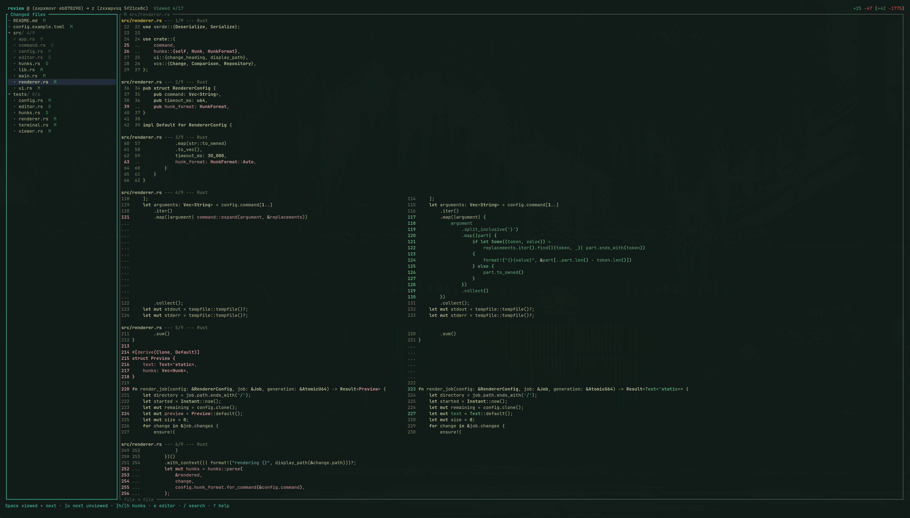

# Review

A keyboard-driven branch review TUI built with Rust and Ratatui. Browse a file
tree, read syntax-aware diffs from [Difftastic](https://difftastic.wilfred.me.uk/),
mark files viewed, and pick up where you left off.



## Install

Requires Rust 1.88+, Git, and `difft` on `PATH`. Jujutsu reviews use `jj` 0.46+
(the structured diff template interface).

```sh
cargo install --path .
```

## Start a review

```sh
# Review the current directory's repository against master
review

# Compare two change/commit IDs, branches, or bookmarks directly
review ukr..vqm
review master..feature/my-change

# Compare against the current revision (@); these forms are equivalent
review ukr..
review ukr..@
review ukr

# Native revision expressions
review 'trunk()..@'
review --backend git 'HEAD~3..@'

# Git: review the current branch against its merge base with master
review --base master

# Git merge-base shorthand
review --backend git master...feature/my-change

# Explicit merge-base branch comparison
review --base origin/master --head feature/my-change

# Jujutsu: review the working-copy revision against trunk
review --base 'trunk()' --head @

# Select a repository and backend explicitly
review -C ../project --backend git --base master
```

Positional `BASE..HEAD` compares the two snapshots directly. Either omitted
endpoint defaults to `@`, and a lone `REV` means `REV..@`. `@` selects Git's
current `HEAD` or Jujutsu's working-copy revision. Each endpoint accepts the
selected backend's revision syntax and resolves to one revision, including branch
names, commit IDs, jj change IDs, and expressions such as `heads(master::feature)`.
Quote expressions containing shell metacharacters.

Bare `review` defaults to `--base master`. Use `--base` with an optional `--head`
to compare from their unique merge base; Git's positional `BASE...HEAD` uses the
same merge-base behavior. This focuses the review on changes made on the head
branch since the histories diverged.

The nearest repository is detected automatically from the current directory,
with Jujutsu preferred in a colocated workspace. The header displays the resolved
snapshot IDs. Jujutsu reviews show each endpoint's change ID and Git commit hash,
such as `master (ukrwmnxy abcdef12)`.
Added and removed line counts appear at the right edge of the header in green
and red: `+12 -3 (+120 -45)`. The first pair covers the highlighted file or folder;
folder counts include all changed descendants, including viewed files and files
hidden by filters or collapsed folders. The totals in parentheses cover the full
comparison. Both pairs follow the pinned snapshots when resuming or refreshing.

Reviews check the selected revisions in the background about once per second.
Jujutsu `@` follows saved working-copy edits; Git comparisons follow commits as
`HEAD` or branches advance. File trees, file and directory previews, header IDs,
and line totals reload together. Updates save automatically, preserving selection,
pane focus, and scroll positions for unchanged diffs.

Jujutsu checks snapshot the working copy through `jj`, then read file contents at
fixed revisions.

## Stop and resume

```sh
review --resume          # Resume the most recently saved session
review --list            # List saved sessions for this repository/backend
review --resume <id>     # Resume a particular session
review --base master       # Start a fresh review
```

Press `q` or `Ctrl-c` to save and quit. Viewed changes save immediately;
navigation state autosaves within 250 ms. Resume restores the comparison,
viewed files, selection, pane focus, directory expansion, filters, layout,
tree width, and per-file and per-directory scroll positions.

Sessions belong to the canonical workspace path and selected backend. Use the
same backend when resuming a session created with `--backend git` in a colocated
workspace.

**Resume restores the original snapshots.** Subsequent changes while the review is
open trigger an automatic refresh. Press `r` to resolve the original branch/revision
expressions immediately using the same comparison mode. A viewed marker survives
when both sides of the file change—including paths, types, and executable bits—are
identical. Changes to either side reset its marker; equivalent history rewrites
preserve it. Changed files reappear in the unviewed-only filter.
Keep reviewed commits reachable while a session is active: file rendering reads
their stored objects.

State lives in `$XDG_STATE_HOME/review/` (normally `~/.local/state/review/`). Use
`--state-dir <directory>` for a different location. Saves are atomic, and each
open session holds an exclusive lock.

## Keyboard controls

| Keys | Action |
|---|---|
| `j` / `k`, arrows | Move in the tree or scroll the diff |
| `h` / `l` | Collapse/expand directories or scroll horizontally |
| `Enter` | Toggle a directory or focus the selected file's diff |
| `Tab`, `Ctrl-h` / `Ctrl-l` | Switch panes; focus the tree / diff |
| `Ctrl-Left` / `Ctrl-Right` | Shrink/grow the tree by two columns |
| `gg` / `G`, `Home` / `End` | First/last row or page |
| `Ctrl-d/u`, `Ctrl-f/b`, `PageDown/Up` | Half/full-page scrolling |
| `Space` | Toggle file viewed (advance when marked); mark all files in a folder viewed |
| `]f` / `[f` | Next/previous file, expanding its parents |
| `]u` / `[u` | Next/previous unviewed file |
| `]h` / `[h` | Select and highlight the next/previous diff hunk |
| `e` | Open the selected hunk or file in the editor |
| `/` | Filter filenames in the tree; search text in the diff |
| `s` | Flash jump to a visible tree entry from either pane |
| `n` / `N` | Next/previous matching file or diff search result |
| `u` | Toggle the unviewed-only filter |
| `i` | Toggle inline and side-by-side rendering |
| `z` | Toggle a full-width diff |
| `Esc` | Clear file filters; cancel a search or Flash prompt |
| `r` | Refresh the comparison |
| `?` | Show help and custom key aliases |
| `q`, `Ctrl-c` | Save and quit |

Marking a file viewed advances to the next unviewed file matching the current
filter, expanding its parent folders and wrapping at the end. Pane focus and
layout are retained. Unmarking keeps the current file selected.

Search and filtering are case-insensitive. Directory counts show progress across
their changed files. Pressing `Space` on a folder marks all its changed files
viewed, including nested files and files hidden by filters or collapsed folders.
Highlighting a folder shows a combined diff of all its changed descendants,
including collapsed and filtered-out files, with a heading for each file.
Focus the right pane with `Ctrl-l` or `Tab` to scroll or search the combined diff.
`Space` in a directory preview marks the directory's files viewed.
Viewed files and fully viewed folders appear slightly dimmed in the tree.
Narrow terminals display the focused pane at full width.

### Hunk selection and LazyVim

Use `]h` / `[h` to select a hunk in the configured renderer's output. Selection
wraps, focuses the diff pane, and highlights the hunk while preserving syntax
colors. Folder previews select hunks across all their changed descendants.
Navigation centers the selected hunk within the available scroll range.
Selection follows the same source location when resizing or switching layouts.
`Esc` clears the hunk selection.

Press `e` to open the selected hunk at its source line. With the diff pane focused,
`e` also opens the nearest displayed hunk; from the file tree it opens the file.
The default command launches a new terminal window running `nvim`, using your
normal Neovim/LazyVim configuration. It requires `xdg-terminal-exec` and `nvim`.

Locations follow the reviewed snapshots. Lines shifted by working-copy edits are
mapped to their current location on disk. Deleted files, replaced lines, and
old-side-only locations open a read-only snapshot stored under the repository's
review state directory. Snapshot files retain their filename extension and remain
available after review exits.

Hunk adapters recognize Difftastic, `diff`, and Git unified output automatically.
Difftastic's colored line numbers identify changed lines (`--color=always`, as in
the default configuration). Plain Difftastic output provides old-side hunk-start
locations. For wrapper scripts, set `[renderer] hunk_format = "difftastic"` or
`"unified"`. `"none"` uses file-level editor opening.

### Flash navigation

Press `s` from either pane, type a filename fragment, then press a highlighted
label to select that file or folder in the tree. Jump keys are case-sensitive,
using lowercase labels first, then uppercase labels for additional matches.
Press each label exactly as displayed. Keep typing to narrow the case-insensitive
matches; `Backspace` edits the fragment, and `Enter` selects the first match.

The typed fragment highlights within each matching name. Jump labels overlay the
second character after each match, keeping its next character visible. Repeated
matches in the same entry share a jump key. Labels leave other matches and their
continuations visible, and use letters that keep every visible query extension
available for typing.

Flash searches the visible tree entries, respecting filters and collapsed folders.
It reveals the tree from a full-width diff and focuses the tree after a jump.
Press `Esc` to restore the previous pane and layout.

## Configuration

Create `$XDG_CONFIG_HOME/review/config.toml` (normally
`~/.config/review/config.toml`), or pass `--config <file>`. See
[`config.example.toml`](config.example.toml).

```toml
[renderer]
command = ["diff", "-u", "{old}", "{new}"]
timeout_ms = 30000

[editor]
command = ["xdg-terminal-exec", "--", "nvim", "+{line}", "{read_only}", "--", "{file}"]

[keybindings]
J = "next_file"
K = "previous_file"
v = "toggle_viewed"
"Ctrl-j" = "next_unviewed"
```

Renderers receive temporary files containing the reviewed snapshots. Arguments
are passed directly to the executable; use a wrapper script for pipelines.
Supported placeholders are `{old}`, `{new}`, `{path}`, `{width}`, and `{display}`
(`inline` or `side-by-side`). Filenames/extensions are preserved for language
detection. ANSI colors are rendered inside the TUI. Exit codes 0 and 1 support
conventional diff tools.

Editor arguments are also passed directly, with `{file}`, `{line}`, `{column}`,
and `{repo}` placeholders. `{read_only}` expands to `-R` for snapshots; a
standalone `{read_only}` argument is omitted for working files. The launcher also
receives `REVIEW_EDITOR_READ_ONLY=1` for snapshots and `0` for working files.
Use an editor bridge script to customize window selection or editor integration.
Editor preparation and launching run in the background; failures appear in the
footer.

Diff jobs run in the background. Superseded jobs are cancelled, completed views
are cached, and resizing re-renders for the current pane width. Renderer output
is limited to 16 MiB per job, with one configured timeout budget for each file or
directory preview.
Binary changes, renames, symlinks, executable-bit changes, submodule pointers,
and Jujutsu conflict contents remain visible through file metadata and diffs.

Key aliases supplement the defaults in navigation mode; search and Flash prompts
use typed characters for their own input. Keys may be a character, a named key
(`Space`, `Enter`, `Tab`, `BackTab`, `Esc`, `Backspace`, arrows, `PageUp`,
`PageDown`, `Home`, `End`), or a `Ctrl-`/`Alt-` combination. Use uppercase
characters for shifted letters.
`Ctrl-c` always saves and exits.

Actions: `up`, `down`, `left`, `right`, `focus_tree`, `focus_diff`, `first`, `last`,
`page_down`, `page_up`, `half_page_down`, `half_page_up`, `next_file`,
`previous_file`, `next_unviewed`, `previous_unviewed`, `next_hunk`, `previous_hunk`,
`open_editor`, `toggle_viewed`,
`toggle_unviewed`, `toggle_inline`, `toggle_fullscreen`, `search`, `flash`,
`next_match`, `previous_match`, `refresh`, `clear_filters`, `help`, `quit`.

## Development

```sh
cargo test
cargo fmt --check
cargo clippy --all-targets -- -D warnings
```

Integration tests use temporary repositories created through Jujutsu and require
Git, `jj`, `difft`, standard `diff`/`sleep`/`cat` tools, and a POSIX shell.
Unix PTY tests cover the application, autosave, resumed file and directory
previews, key aliases, and terminal restoration.
